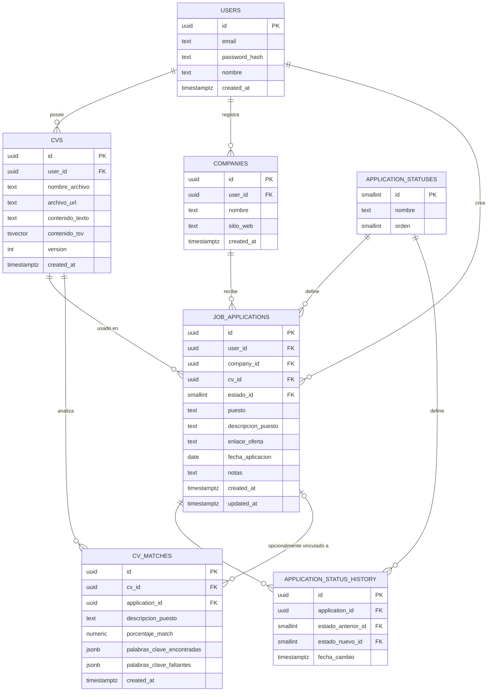

# Arquitectura del Proyecto

## Frontend

**Lenguaje recomendado: JavaScript**

- La aplicación es un sitio/aplicación web con formularios (registro de empresa, puesto, estado, CV) y una vista para la revisión tipo ATS, por lo que necesita una interfaz interactiva en el navegador. Python no se usa de forma nativa para construir interfaces de este tipo (salvo herramientas como Streamlit/Dash, pensadas para dashboards simples, no para una app de formularios y flujos de usuario).
- JavaScript (con un framework como React, Vue o Svelte) es el estándar de facto para este tipo de interfaz, ya que corre directamente en el navegador.

**Otras consideraciones**

- Necesidad de manejar carga de archivos (el CV) desde el formulario.
- Necesidad de mostrar el resultado del nivel de matching (ATS) de forma clara, posiblemente con visualización (porcentaje, lista de coincidencias/faltantes).
- Manejo de distintos estados de la solicitud (edición, filtrado, actualización) en la interfaz.

### Comparación de frameworks

La aplicación es un dashboard privado tras login (formularios, tabla de solicitudes con filtrado, carga de CV, vista de resultados ATS), no un sitio público que necesite SEO/SSR.

| Framework | A favor | En contra para este proyecto |
|---|---|---|
| **React** (Vite) | Ecosistema más grande y maduro para lo que necesita esta app: formularios (`react-hook-form` + `zod`), tablas con filtrado (`TanStack Table`), fetching/cache de API (`TanStack Query`), carga de archivos (`react-dropzone`), gráficos para el % de matching (`recharts`). Amplia disponibilidad de kits de componentes para armar CRUD rápido. | Requiere más piezas sueltas (routing, forms, data-fetching son librerías separadas) — más decisiones de setup inicial. |
| **Vue** (Vite) | Curva de aprendizaje más suave, librerías "todo en uno" (Vuetify, PrimeVue) que aceleran CRUD con menos código. | Ecosistema más pequeño que React; menos soporte para casos específicos como visualización de matching. |
| **Svelte/SvelteKit** | Menos boilerplate, bundles más livianos. | Ecosistema de componentes/librerías considerablemente más chico para una app con varios formularios y vistas de datos. |
| **Next.js** (React) | Meta-framework completo, SSR/routing integrado. | Su valor principal es SSR/SEO/routing para sitios públicos; esta app no lo necesita — añade complejidad de despliegue sin beneficio claro. |

### Decisión recomendada: React + Vite (SPA)

- **Por qué SPA y no un meta-framework:** al ser un dashboard autenticado (no un sitio público indexable), no hay necesidad de SSR. Un SPA con Vite es más liviano, se compila a estático y se despliega de forma independiente de la API en Python.
- **Por qué React:** el caso de uso (formularios + tabla filtrable + carga de archivo + gráfico de porcentaje) está resuelto de forma madura por su ecosistema, minimizando código custom.

**Stack propuesto:**

- **Build tool:** Vite
- **Routing:** React Router
- **Formularios/validación:** `react-hook-form` + `zod`
- **Data fetching/cache (consumo del REST API):** `TanStack Query`
- **Tabla de solicitudes (filtrar/ordenar):** `TanStack Table`
- **Carga de CV:** `react-dropzone`
- **Visualización de % de matching:** `recharts` (barra/gauge simple)
- **CSS/componentes: Tailwind CSS + shadcn/ui** (reemplaza a Bootstrap — ver justificación abajo)
  - Componentes para los patrones de esta app: `Dialog`/`Sheet` para crear/editar solicitudes, `Table` para el listado, `Badge` para el estado de cada solicitud, `Progress` para el porcentaje de matching ATS, `Toast` (sonner) para feedback de acciones.
  - Tokens de diseño (colores, radios, espaciado) centralizados en `tailwind.config.js`, fáciles de ajustar sin tocar componente por componente.
  - `shadcn/ui` no es una dependencia npm tradicional: los componentes (basados en primitivas accesibles de Radix) se copian al repo, así que quedan totalmente editables en vez de depender de la API/estética que exponga una librería externa.

**Por qué Tailwind y no Bootstrap:** la ventaja original de Bootstrap era que `react-bootstrap` lo integraba de forma nativa y tipada en React, algo que Vue/Svelte no tienen igual de bien resuelto. Pero Tailwind es solo utilidades CSS (no una librería de componentes atada a un framework), así que esa ventaja no aplica — cualquier framework lo consume igual. Con `shadcn/ui` se recupera el mismo nivel de "componentes listos para usar" que daba `react-bootstrap` (modales, badges, progress bars, tablas), pero con mejor tree-shaking (Tailwind solo compila las clases realmente usadas, sin el CSS completo de Bootstrap) y sin heredar la estética por defecto de Bootstrap — los tokens de diseño quedan abiertos para un look propio del proyecto.

## Backend

**Comparación Python vs JavaScript**

- El apartado de revisión de CV tipo ATS requiere procesar texto (el CV y la descripción del puesto) para obtener un nivel de matching. Python cuenta con un ecosistema más maduro para procesamiento de texto/NLP (librerías como spaCy, NLTK, scikit-learn) y para la extracción de texto de archivos de CV (PDF, Word).
- JavaScript (Node.js) también puede realizar estas tareas, pero con un ecosistema de NLP más limitado en comparación con Python.
- Dado que el proyecto se apoya en esta funcionalidad de comparación/matching, **Python sería la mejor opción para el backend** según lo descrito en project_description.md.

**Otras consideraciones**

- Extracción de texto desde distintos formatos de CV (PDF, Word).
- Definición del método de matching a utilizar entre el CV y la descripción del puesto.
- Exposición de una API para que el frontend (en JavaScript) consuma tanto el CRUD de solicitudes como el resultado del matching.
- Posibilidad de usar Python en el backend y JavaScript en el frontend como una arquitectura separada (backend con API + frontend independiente).
- **Framework recomendado: FastAPI** — genera automáticamente el esquema OpenAPI usado para documentar el REST API (ver apartado API) y su soporte async es útil si `/api/ats-review` crece en duración de procesamiento. Detalle de despliegue en el apartado Infraestructura / Despliegue.

## Base de datos

### Motor seleccionado: PostgreSQL

Se elige **PostgreSQL** (vs. MySQL/SQL genérico) por encajar mejor con los dos módulos del proyecto:

- **Integridad relacional fuerte**: las solicitudes de trabajo dependen de relaciones claras (usuario → CV → solicitud → historial de estado) que se benefician de FKs, transacciones ACID y constraints.
- **Tipos avanzados nativos**: `ENUM` para el estado de la solicitud, `JSONB` para guardar resultados de análisis ATS (listas de palabras clave encontradas/faltantes) sin necesitar tablas adicionales rígidas, y `UUID` como PK para IDs no adivinables si la app se expone públicamente.
- **Búsqueda de texto completo integrada**: el módulo ATS necesita comparar el texto del CV contra la descripción del puesto. PostgreSQL trae `tsvector`/`tsquery` y extensiones (`pg_trgm`, `unaccent`) para matching de palabras clave y similitud difusa (útil para español, con tildes/variantes) sin depender de un motor de búsqueda externo (Elasticsearch, etc.) en una primera versión.
- **Camino de crecimiento hacia matching semántico**: si en el futuro el "nivel de matching" evoluciona de conteo de palabras clave a similitud semántica (embeddings), la extensión `pgvector` permite agregar esa capacidad sin migrar de motor.
- **Costo/operación**: gratuito, open source, con soporte nativo en la mayoría de proveedores (Supabase, RDS, Render, Railway, Docker local), lo que facilita tanto desarrollo local como despliegue.

MySQL/SQLite quedan descartados como opción principal: SQLite no es apto para concurrencia multiusuario en producción, y MySQL no ofrece `tsvector`/`pg_trgm`/`JSONB` con la misma madurez, obligando a resolver el matching de texto en la capa de aplicación.

### Diagrama entidad-relación

### Descripción de entidades

| Tabla | Propósito |
|---|---|
| `users` | Cuenta del usuario dueño de los datos (soporta autenticación y aislamiento de datos entre usuarios). |
| `companies` | Empresas a las que se ha aplicado, normalizadas por usuario para evitar duplicados/typos y habilitar reportes ("solicitudes por empresa"). |
| `cvs` | Versiones de CV subidas por el usuario. Se guarda el archivo original (en storage externo) y el texto extraído, usado tanto para mostrarlo como para el matching ATS. |
| `application_statuses` | Catálogo de estados posibles (Aplicado, En revisión, Entrevista, Oferta, Rechazado, Retirado, etc.), modelado como tabla en vez de `ENUM` fijo para permitir que el usuario personalice/reordene estados sin migración de esquema. |
| `job_applications` | Entidad central: una solicitud de trabajo con empresa, puesto, estado actual y CV utilizado. |
| `application_status_history` | Auditoría de cambios de estado de una solicitud (cuándo pasó de "Aplicado" a "Entrevista", etc.), útil para métricas de tiempo por etapa. |
| `cv_matches` | Resultado de un análisis tipo ATS: porcentaje de coincidencia y detalle de palabras clave encontradas/faltantes entre un CV y una descripción de puesto. Puede vincularse a una `job_application` existente o usarse de forma independiente (revisión rápida sin crear solicitud). |

### Relaciones clave

- Un usuario tiene muchos CVs, muchas empresas registradas y muchas solicitudes (`1:N`).
- Una solicitud pertenece a un único usuario, una única empresa y usa un único CV vigente (`N:1` en cada caso), con `ON DELETE RESTRICT` en `cv_id`/`company_id` para no perder historial si se intenta borrar un CV o empresa referenciada (se recomienda "soft delete" con columna `archived_at` en vez de borrado físico en `cvs` y `companies`).
- El estado de una solicitud es una FK a `application_statuses`; cada cambio de estado inserta una fila en `application_status_history` (vía trigger o lógica de aplicación) para mantener trazabilidad.
- `cv_matches.application_id` es **nullable**: permite usar el analizador ATS de forma exploratoria (pegar una descripción de puesto sin crear una solicitud formal) y opcionalmente asociarlo después.

### Índices y optimizaciones

- `job_applications(user_id, estado_id)` — listar/filtrar solicitudes por estado en el dashboard principal.
- `job_applications(user_id, fecha_aplicacion DESC)` — orden cronológico por defecto.
- `companies(user_id, lower(nombre))` con `UNIQUE` — evita duplicar la misma empresa con distinto casing.
- Índice `GIN` sobre `cvs.contenido_tsv` (columna `tsvector` generada, `GENERATED ALWAYS AS (to_tsvector('spanish', contenido_texto)) STORED`) para búsqueda/matching de palabras clave eficiente.
- Índice `GIN` con `pg_trgm` sobre `job_applications.puesto` y `companies.nombre` para autocompletado/búsqueda difusa.
- `cv_matches(cv_id, created_at DESC)` — obtener el análisis más reciente de un CV.

### Extensiones recomendadas

- `pgcrypto` o `uuid-ossp` — generación de `UUID` como PK (`gen_random_uuid()`).
- `pg_trgm` — similitud de texto para búsqueda y comparación difusa de palabras clave (maneja variantes/errores tipográficos).
- `unaccent` — normaliza tildes en español al indexar/comparar texto, relevante porque tanto CVs como descripciones de puesto estarán mayormente en español.
- `pgvector` (opcional, futuro) — si el matching ATS evoluciona a comparación semántica vía embeddings en lugar de solo keywords.

### Integridad y auditoría

- Todas las tablas incluyen `created_at`/`updated_at` (`timestamptz`) para trazabilidad.
- `porcentaje_match` con `CHECK (porcentaje_match BETWEEN 0 AND 100)`.
- Borrado en cascada (`ON DELETE CASCADE`) solo desde `users` hacia sus propios datos (`cvs`, `companies`, `job_applications`); dentro de las relaciones entre `job_applications` y `cvs`/`companies` se prefiere `RESTRICT` + soft delete para no romper el historial de solicitudes ya enviadas.
- `application_status_history` es de solo inserción (append-only): no se actualiza ni borra, sirve como bitácora inmutable del progreso de cada solicitud.

## API

### Análisis

El proyecto tiene dos tipos de operaciones bien diferenciadas:

1. **CRUD simple sobre un recurso** (solicitudes de trabajo: empresa, puesto, estado, CV utilizado).
2. **Una operación de procesamiento/análisis** (comparar CV vs. descripción del puesto y devolver un nivel de coincidencia tipo ATS), que no es una simple lectura/escritura de datos sino un cálculo que puede tardar más y evolucionar (reglas simples de keywords al inicio, posiblemente NLP/IA más adelante).

No hay indicios de que se necesiten múltiples clientes con requisitos de datos muy distintos (app móvil, dashboards de terceros, agregación de varias fuentes), ni de consultas anidadas complejas — el dominio es pequeño (una tabla principal de solicitudes + un endpoint de análisis). Estas son justamente las condiciones donde GraphQL añade complejidad sin aportar beneficio real, y donde tRPC exige atarse a un stack full-stack TypeScript específico (p. ej. Next.js) desde el día uno.

### Opciones consideradas

| Opción | A favor | En contra para este proyecto |
|---|---|---|
| **REST** | Simple, agnóstico de stack, tooling maduro (OpenAPI/Swagger), cacheable, fácil de documentar y de testear, es el estándar más usado y entendido | Menos "type-safety" automática entre frontend y backend que tRPC |
| **GraphQL** | Consultas flexibles, útil con muchos clientes o fuentes de datos heterogéneas | Sobrecarga de diseño (schema, resolvers) injustificada para un CRUD pequeño + un endpoint de análisis |
| **tRPC** | Tipado end-to-end sin escribir schemas, muy rápido de desarrollar en un monorepo TypeScript | Acopla fuertemente frontend y backend al mismo lenguaje/framework (ej. Next.js); poco portable si en el futuro se agrega una app móvil u otro cliente |

### Decisión recomendada: REST (JSON) documentada con OpenAPI

Es la opción con mejor relación simplicidad/beneficio para el alcance actual del proyecto, y no cierra puertas a futuro (cualquier cliente —web, móvil, CLI— puede consumirla).

**Estructura de recursos propuesta:**

- `GET /api/applications` — listar solicitudes (con filtros por estado, empresa, etc.)
- `POST /api/applications` — crear una solicitud
- `GET /api/applications/{id}` — obtener una solicitud
- `PUT/PATCH /api/applications/{id}` — actualizar una solicitud (incluye cambio de estado)
- `DELETE /api/applications/{id}` — eliminar una solicitud
- `POST /api/ats-review` — recibe CV + descripción del puesto (o referencia a una solicitud existente) y devuelve el porcentaje/nivel de coincidencia y el detalle (palabras clave encontradas/faltantes)

**Consideraciones adicionales:**

- `POST /api/ats-review` es la operación más costosa (procesamiento de texto/CV). Si el análisis crece en complejidad (uso de un modelo de IA, parsing de PDF), conviene diseñarlo desde ahora como potencialmente asíncrono (respuesta con estado "processing" + consulta posterior del resultado) para no bloquear al cliente.
- Versionar la API desde el inicio (`/api/v1/...`) evita romper clientes cuando el modelo de matching cambie.
- Formato de respuesta consistente (envelope con `data`/`error`) y códigos HTTP estándar.
- Reevaluar esta decisión si el proyecto migra a un monorepo TypeScript de un solo cliente web (ej. Next.js): en ese escenario tRPC sería una alternativa razonable por el tipado end-to-end.

Sources:
- [tRPC vs GraphQL vs REST: Choosing the right API design for modern web applications](https://sdtimes.com/graphql/trpc-vs-graphql-vs-rest-choosing-the-right-api-design-for-modern-web-applications/)
- [The Complete Guide to API Design in 2026: REST, GraphQL, and tRPC in Production](https://dev.to/zny10289/the-complete-guide-to-api-design-in-2026-rest-graphql-and-trpc-in-production-4ib2)
- [REST vs GraphQL vs tRPC vs gRPC in 2026: The Definitive Guide to Choosing Your API Layer](https://dev.to/pockit_tools/rest-vs-graphql-vs-trpc-vs-grpc-in-2026-the-definitive-guide-to-choosing-your-api-layer-1j8m)
- [tRPC vs REST vs GraphQL for B2B SaaS APIs in 2026](https://www.duskolicanin.com/blog/trpc-vs-rest-vs-graphql-b2b-saas-2026)

## Autenticación

## Infraestructura / Despliegue

### Componentes a desplegar

| Componente | Qué es | Dónde vive |
|---|---|---|
| Frontend | Build estático de React + Vite (SPA) | Hosting estático / CDN |
| Backend | API REST en Python (FastAPI) | Servicio de aplicación (contenedor) |
| Base de datos | PostgreSQL | Servicio de base de datos administrado |
| Almacenamiento de archivos | CVs subidos (PDF/Word) | Object storage compatible con S3 |

El frontend es un SPA estático y el backend es una API independiente (ver decisión REST del apartado API): se despliegan y escalan por separado, sin acoplamiento de infraestructura entre ellos — solo se comunican vía HTTP.

### Frontend: hosting estático

| Opción | A favor | En contra |
|---|---|---|
| **Cloudflare Pages** | CDN global, despliegue automático desde Git, HTTPS y preview deployments gratis, sin cold starts (es solo estático) | — |
| Vercel | Muy buena DX, mismo modelo de despliegue | Optimizado principalmente para Next.js; para un SPA plano no aporta más que Cloudflare Pages |
| Netlify | Equivalente a Cloudflare Pages | Free tier más limitado en ancho de banda |

**Decisión: Cloudflare Pages.** El build de Vite (`npm run build` → carpeta `dist/`) se sirve como estático desde el edge, con despliegue automático en cada push a `main` y preview URLs por cada PR.

### Backend: hosting de la API

| Opción | A favor | En contra |
|---|---|---|
| **Render** | Soporta Python nativo o Docker, Postgres administrado desde el mismo panel si se quisiera, variables de entorno y logs simples, HTTPS automático | Free tier con "cold start" tras inactividad (aceptable para un proyecto personal) |
| Railway | Similar a Render, buena DX | Modelo de precios menos predecible a futuro |
| Fly.io / VPS propio | Máximo control, sin cold starts | Requiere administrar más infraestructura a mano — no se justifica en esta etapa |

**Decisión: Render**, como **Web Service** desplegado vía Docker (el mismo `Dockerfile` sirve para desarrollo local y producción, evitando divergencia entre ambos).

### Base de datos y almacenamiento: Supabase

**Decisión: Supabase** (Postgres administrado + Storage) en vez de contratar ambos servicios por separado:

- **Postgres administrado**: el mismo motor decidido en el apartado Base de datos, con extensiones (`pg_trgm`, `unaccent`, `pgvector`) habilitables desde el panel sin configuración manual.
- **Storage (S3-compatible)**: para los archivos de CV subidos (PDF/Word) — la tabla `cvs` guarda la referencia/URL al archivo en Storage y el texto ya extraído en Postgres (`contenido_texto`), nunca el binario.
- Un solo proveedor para base de datos y archivos reduce la cantidad de credenciales y paneles a mantener, razonable para el tamaño actual del proyecto. Al ser Postgres estándar, no hay *lock-in* de datos: se puede migrar a Render Postgres/RDS + un bucket S3 más adelante sin reescribir el modelo.

### Variables de entorno

| Variable | Dónde se usa | Propósito |
|---|---|---|
| `DATABASE_URL` | Backend | Conexión a Postgres (Supabase) |
| `SUPABASE_URL` / `SUPABASE_SERVICE_KEY` | Backend | Subir y leer archivos de CV en Storage |
| `SECRET_KEY` / `JWT_SECRET` | Backend | Firma de tokens de sesión (una vez definida la autenticación) |
| `CORS_ORIGINS` | Backend | Lista blanca de orígenes permitidos (dominio del frontend) |
| `VITE_API_URL` | Frontend (build-time) | URL base de la API para las peticiones del cliente |

### CI/CD

- **GitHub Actions** en cada PR: lint + tests del backend (`pytest`), build de verificación del frontend (`npm run build`) y chequeo de que las migraciones corren limpio contra una base de datos de prueba.
- **Despliegue continuo** al hacer merge a `main`: Cloudflare Pages y Render observan el repositorio directamente y despliegan sin pasos manuales — Actions solo bloquea el merge si algo falla, no orquesta el deploy.
- **Migraciones de base de datos**: con Alembic (SQLAlchemy), ejecutadas como paso de "pre-deploy" en Render antes de que la nueva versión de la API reciba tráfico.

### Entornos

- **Local**: `docker-compose` con backend + Postgres local (o apuntando a un proyecto de Supabase de desarrollo), para no depender de internet al desarrollar.
- **Producción**: Cloudflare Pages (frontend) + Render (backend) + Supabase (datos/archivos), con un proyecto de Supabase separado para desarrollo y otro para producción, de modo que los datos de prueba nunca se mezclen con los reales.
- Un entorno de *staging* dedicado es opcional a este tamaño de proyecto: los *preview deployments* de Cloudflare Pages por PR ya cubren buena parte de esa necesidad del lado del frontend.

### Dominio y TLS

- Un dominio propio (ej. `jobtracker.app`) con dos subdominios: la raíz o `app.` apuntando a Cloudflare Pages (frontend) y `api.` apuntando a Render (backend).
- Certificados HTTPS gestionados automáticamente por ambos proveedores, sin configuración manual de TLS.
- El backend debe permitir explícitamente el origen del frontend en `CORS_ORIGINS`, ya que viven en dominios/subdominios distintos.

### Observabilidad

- Los logs y métricas básicas incluidos en Render (backend) y Cloudflare Pages (frontend) son suficientes para el tamaño actual del proyecto.
- Si el proyecto crece (más usuarios, necesidad de alertas), agregar **Sentry** (con SDKs para FastAPI y para React) es el siguiente paso natural antes de invertir en un stack de observabilidad más pesado.
